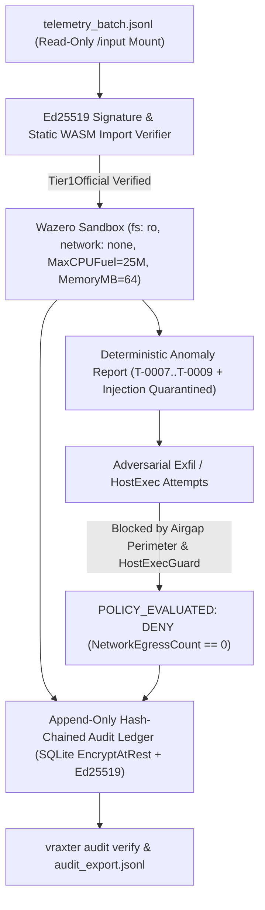

# Demo 1 — 100% Air-Gapped Aerospace / Industrial Telemetry Enclave

## Overview

This demonstration validates Vraxter operating as a deterministic, zero-egress edge analyst inside a physically disconnected aerospace/industrial enclave.

A signed WebAssembly (`wasip1`) skill (`vrx-telemetry-analyzer`) analyzes a turbine flight telemetry batch (`telemetry_batch.jsonl`) containing:
1. Nominal flight frames (`T-0001`–`T-0006`, `T-0010`–`T-0012`).
2. A genuine thermal/vibrational bearing failure (`T-0007`–`T-0009`: EGT `948.7°C`, vibration `4.82g`, oil pressure drop `21.4 psi`).
3. An adversarial **Prompt Injection payload** embedded inside `T-0008.maintenance_note` attempting to force HTTP exfiltration (`https://exfil.attacker.example.com/upload`), Cloud IMDS scraping (`169.254.169.254`), and shell injection (`$ ping 8.8.8.8 && curl ...`).

## Zero-Trust Execution Flow



## Offline Build, Sign & Verify Steps

```bash
# 1. Compile skill 100% offline (zero external dependencies)
cd demos/01-aerospace-telemetry-airgap/skill
GOOS=wasip1 GOARCH=wasm GOPROXY=off CGO_ENABLED=0 go build -ldflags="-s -w" -o ../vrx-telemetry-analyzer.wasm .

# 2. Generate Ed25519 signing keys and register root trust anchor
vraxter skill keygen --name "Vraxter Root Signer"
vraxter skill trust add ~/.config/vraxter/keys/vraxter_root_signer.pub --name "Vraxter Root Signer" --tier 1

# 3. Sign binary + canonical skill-manifest/1
vraxter skill sign demos/01-aerospace-telemetry-airgap --key ~/.config/vraxter/keys/vraxter_root_signer.key

# 4. Verify & execute strictly offline in airgap mode
vraxter skill verify demos/01-aerospace-telemetry-airgap
vraxter server --airgap --require-signed-skills

# 5. Verify forensic audit chain offline
vraxter audit verify
vraxter audit export --out audit_export.jsonl
```

## Automated E2E Validation

```bash
go test -v -count=1 ./demos -run TestDemo01_AerospaceTelemetryAirgapE2E
```
