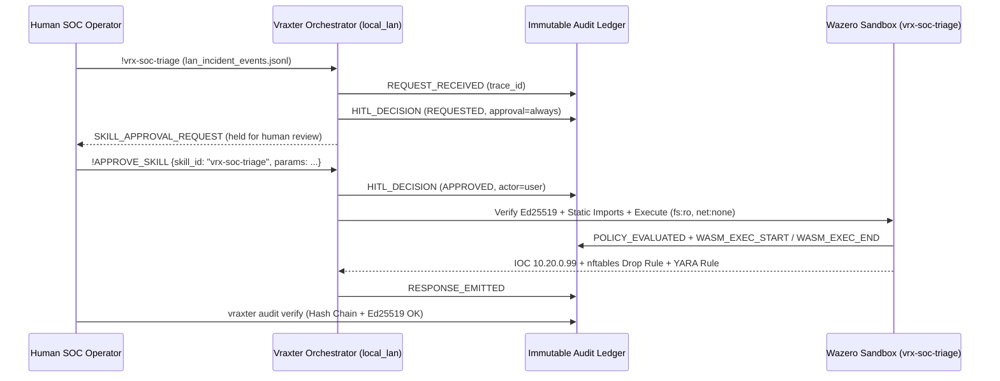

# Demo 2 — Autonomous Sovereign SOC Triage in Isolated LAN

## Overview

This demonstration validates Vraxter operating inside an isolated `local_lan` SOC enclave with zero WAN access (`NetworkEgressCount() == 0`).

Starting from raw isolated-subnet security telemetry (`lan_incident_events.jsonl`) showing lateral port scanning (`22, 445, 3389, 5432`), SSH brute-force attempts, and a suspicious stage-2 beacon payload (`4D5A9000_BEACON_C2_STAGE2`) originating from `10.20.0.99`, Vraxter:
1. Compiles the specialized WASI triage module `vrx-soc-triage` **100% offline (`GOPROXY=off`)**.
2. Runs static WebAssembly bytecode import verification (`VerifyWASMFile`) and Ed25519 signature verification (`require_signed_skills: true`).
3. Enforces the **Human-in-the-Loop (HITL) Decision Bridge** (`agent.approval: "always"`): holds execution at `HITL_DECISION: REQUESTED` until explicit human authorization (`!APPROVE_SKILL`).
4. Emits structured containment proposals (`nftables` drop rule + `YARA` signature) and cryptographically validates the entire causal trail via `VerifyChain()`.

## HITL Decision Bridge Sequence



## Offline Build, Sign & Run Steps

```bash
# 1. Compile SOC triage skill 100% offline
cd demos/02-sovereign-soc-triage/skill
GOOS=wasip1 GOARCH=wasm GOPROXY=off CGO_ENABLED=0 go build -ldflags="-s -w" -o ../vrx-soc-triage.wasm .

# 2. Sign and register under trusted_signers/
vraxter skill sign demos/02-sovereign-soc-triage --key ~/.config/vraxter/keys/vraxter_root_signer.key
vraxter skill verify demos/02-sovereign-soc-triage

# 3. Run automated E2E SOC triage + HITL verification
go test -v -count=1 ./demos -run TestDemo02_SovereignSOCTriageE2E
```
