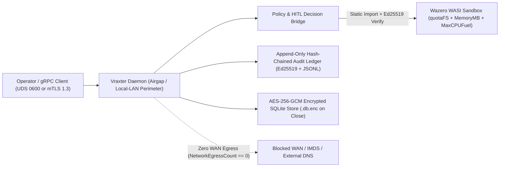

# Vraxter Dual-Use Demonstrations (100% Offline, Pure Go `CGO_ENABLED=0`)

This directory contains two self-contained, reproducible, dual-use demonstrations validating Vraxter's Zero-Trust runtime guarantees for air-gapped aerospace/industrial enclaves and sovereign isolated-LAN SOC deployments.

## Included Demonstrations

| Demo | Domain | Isolation Mode | Security Guarantees Demonstrated |
| :--- | :--- | :---: | :--- |
| **[01-aerospace-telemetry-airgap](01-aerospace-telemetry-airgap/README.md)** | Aerospace / Industrial Edge Telemetry | `--airgap` | Offline `wasip1` build (`GOPROXY=off`), Ed25519 signing (`require_signed_skills=true`), read-only `/input` mount, prompt-injection exfil/shell containment (`NetworkEgressCount == 0`), AES-256-GCM sealed SQLite (`EncryptAtRest`), forensic `VerifyChain()` + `audit_export.jsonl`. |
| **[02-sovereign-soc-triage](02-sovereign-soc-triage/README.md)** | Sovereign SOC Incident Response | `local_lan` | Offline `wasip1` skill synthesis & static bytecode import verification, lateral-scan & brute-force IOC extraction, structured `nftables` + `YARA` containment drafting, strict HITL Decision Bridge hold (`approval: "always"` → `HITL_DECISION: REQUESTED` → `!APPROVE_SKILL` → `APPROVED`), full causal ledger integrity. |

## Zero-Trust Architecture



## Quick Start

### 1. Run Both End-to-End Demos Automatically (100% Offline)

```bash
go test -v -count=1 ./demos/...
```

### 2. CLI Workflow Reference

```bash
# Generate Ed25519 signing identity and register root trust anchor
vraxter skill keygen --name "Vraxter Root Signer"
vraxter skill trust add <pubkey.pub> --name "Vraxter Root Signer" --tier 1

# Sign & verify an offline-compiled WASM skill package
vraxter skill sign demos/01-aerospace-telemetry-airgap --key <privkey.key>
vraxter skill verify demos/01-aerospace-telemetry-airgap

# Start the hardened daemon in strict airgap mode requiring signed skills
vraxter server --airgap --require-signed-skills

# Verify and export the immutable hash-chained forensic audit ledger offline
vraxter audit verify
vraxter audit export --out audit_export.jsonl
```

## Verified Performance & Hardening Metrics

Both demonstrations execute on top of the exact runtime hardened and quantitatively measured in [../BENCHMARKS.md](../BENCHMARKS.md) (`tests/benchmarks/`):

- **Zero-Egress Guarantee:** `20/20` outbound WAN/IMDS/WASM/HostExec egress attempts blocked (`100.00%` block rate, `0` permitted connections, `NetworkEgressCount() == 0`).
- **WASM Sandbox Latency:** Warm start `p50 = 1.621 ms` (`7.77x` faster than OS subprocess baseline), Cold start (including static verification, fuel instrumentation, and Ed25519 signature check) `p50 = 2.157 ms`.
- **Deterministic DoS Containment:** Infinite CPU loops trapped deterministically at exact fuel budget (`500/500` units in `8.332 ms`), memory bombs blocked by `MemoryMB`, disk policy violations blocked by `quotaFS`.
- **Offline Skill Pipeline (`GOPROXY=off`):** Full compile + static verify + Ed25519 sign + register + first sandbox run completed in `< 3 s` (`2.92 s`).
- **Forensic Audit Ledger:** `1,388 ops/sec` chained SHA-256 + Ed25519 append (`p50 = 0.584 ms`), `14,164 events/sec` full offline `VerifyChain()`.
