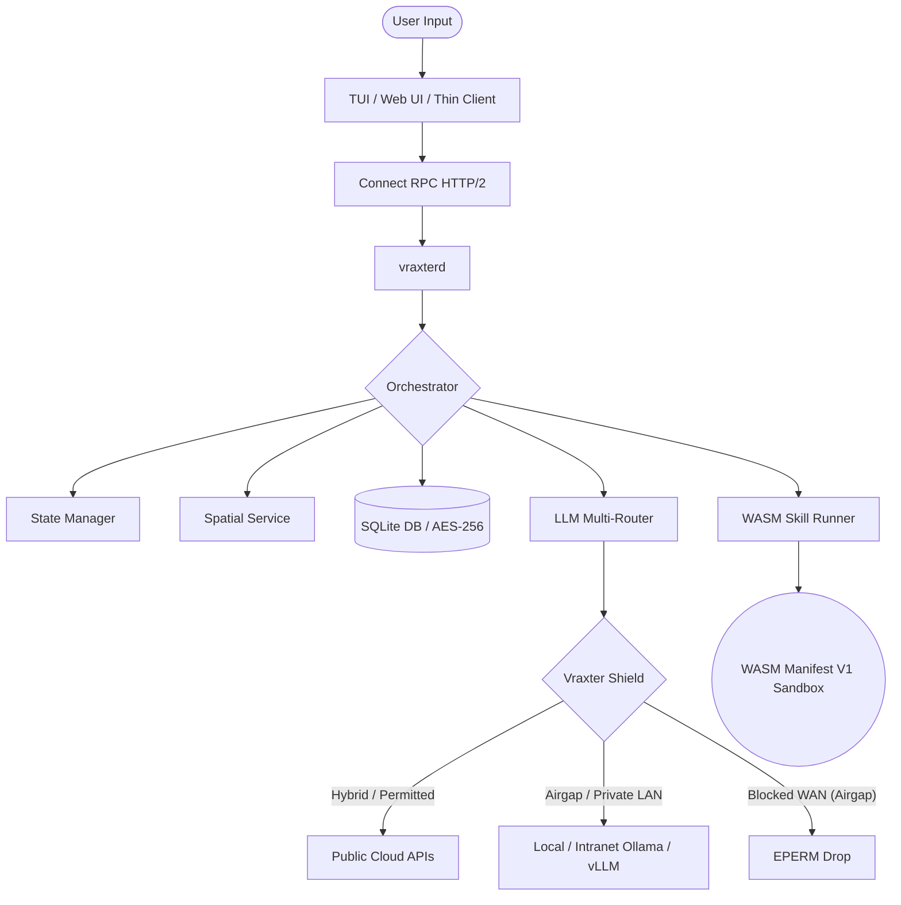

# Vraxter Architecture Guide

Vraxter is engineered as a **distributed, headless autonomous engine** consisting of a persistent background daemon and a high-performance terminal interface.

## System Overview

The system follows a headless Client-Server architecture over **Connect RPC (HTTP/2)**, ensuring that the "brain" (state, memory, execution) remains completely decoupled from any specific frontend (TUI, Svelte web dashboard, or Smart Speaker).

### 1. The Daemon (`vraxterd`)
The daemon is the primary source of truth. It manages:
- **Persistence**: SQLite-backed history, specialists, and model configurations with AES-256-GCM encryption at rest.
- **Environmental Context Engine**: A thread-safe `StateManager` that manages dynamic `ModeConfig` templates (e.g. ambient lighting, music).
- **Orchestration**: The request lifecycle from intent resolution to multi-phase execution.
- **Skill Runner**: The Wazero-powered WASM sandbox supporting Go, Rust, and Zig, strictly bounded by Skill Manifest V1 capability declarations and scoped storage pools (`workspace`, `input`, `output`, `skill_data`, `ephemeral`).
- **Intelligence**: Model routing and multi-provider coordination.
- **Perimeter & Isolation (Vraxter Shield)**: Real-time network boundary enforcement (`airgap`, `local_lan`, `hybrid`), in-memory DNS inspection, transport-level socket blocking (`NewAirgapDialer`), and anti-downgrade runtime locking.
- **Auth Pipeline**: Scoped-token enforcement and master key dual-authentication (`daemon.key`).

### 2. The Connect RPC Layer
- **Protobuf-Defined**: Every interaction is type-safe and defined in `api/v1`.
- **Client-Agnostic HTTP/2**: Vraxter uses Connect RPC, allowing terminal clients, modern browsers, or headless agents to interact seamlessly without proxying.
- **Streaming**: Supports bidirectional streaming for real-time LLM token delivery, tool progress, and interactive human-in-the-loop approvals.

### 3. The Global Event Bus
Vraxter implements a centralized, asynchronous event streaming pipeline. The Event Bus emits standardized events (`SKILL_APPROVAL_REQUEST`, `TOOL_CALL`, `SPECIALIST_RESULT`, system statuses) ensuring all connected clients react in real-time without polling.

### 4. Spatial & Identity Concurrency
The engine natively supports serving multiple physical rooms simultaneously.
- **Spatial Isolation**: Requests containing a `source_zone` (e.g. "living_room") instantiate separate conversation memory streams.
- **Unified Device Mapping**: The `SpatialService` merges internal `spatial.json` mapping with Google Home SDK data so the AI knows exactly which speakers (`[Nest Audio, TV]`) exist in which rooms.
- **Voice Recognition**: Requests can pass a `source_user`. The Orchestrator automatically fetches that exact User Profile from the database, instantly hot-swapping the AI's identity context even during concurrent multi-user conversations.

### 5. Terminal Workstation (TUI)
Built with Bubble Tea and Lip Gloss following the **Anodized Titanium & Burnished Copper** design system:
- **Double-Rail Command Deck**: Top rail monitors session ID, active provider/model, and live isolation status capsule (`[ 🛡️ AIRGAP LOCKED ]`, `[ 🌐 LAN ONLY ]`, `[ ⚡ HYBRID ]`); bottom rail hosts the primary interaction shelf.
- **Decision Bridge**: Modal approval shelf for human-in-the-loop authorization (`[Y] Execute (WASM Sandbox)` / `[N] Deny Request`).
- **Specialist Swarm UI**: Real-time `@<name>` autocomplete overlays, left-accent specialist message blocks, and dynamic supervisor handoffs.

## The Intelligence Pipeline

Every user request goes through the following stages:

### A. Intent Resolution
Vraxter first determines if the input is:
- **Explicit Command**: Starts with `/` (e.g., `/airgap`, `/plan`, `/specialists`, `/models`).
- **Direct Specialist Delegation**: Starts with `@` (e.g., `@security-auditor audit this`).
- **Direct Skill Call**: Starts with `!` (e.g., `!textstats`).
- **Neural Reasoning**: Natural language query requiring LLM planning or execution.

### B. Planning (Pro-Mode)
For complex queries, the **Planner** breaks the task into a series of **Phases**. Each phase is an atomic goal assigned to either the supervisor or a specific **Specialist**.

### C. Context Assembly
Vraxter dynamically builds a system prompt using:
- **User Profile**: Expertise and interests.
- **Semantic Memory**: RAG-based context from conversation history.
- **Project Structure**: Automated Git context and file tree analysis.
- **Capabilities Matrix**: Listing available WASM tools and active models.

### D. Perimeter Shielding & Execution
Before outbound network calls are made:
- If `isolation_mode: "airgap"` is active, public WAN IP connections are blocked with `syscall.EPERM` by `NewAirgapDialer`. Private LAN endpoints (RFC 1918: `192.168.x.x`, `10.x.x.x`, `172.16.x.x`, `.local`, `.lan`) remain accessible for local Ollama/vLLM servers.

## Data Flow Diagram

