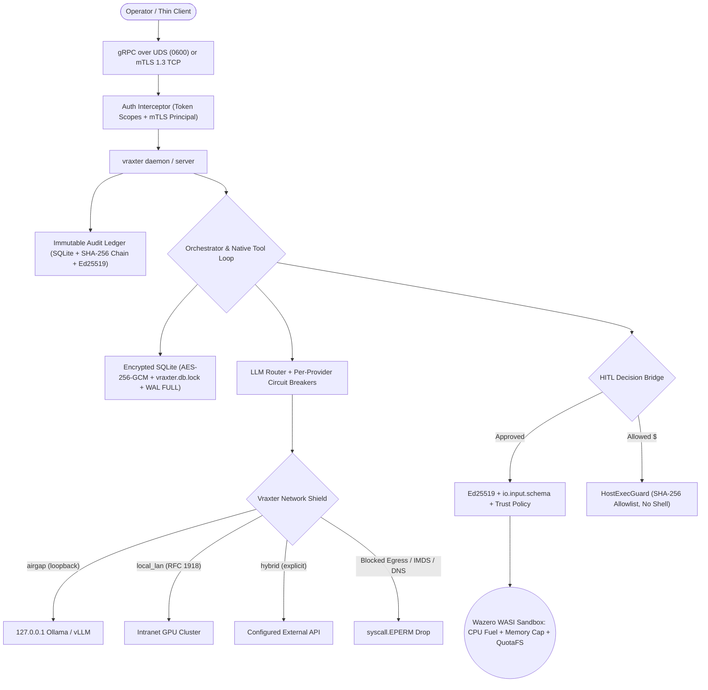

# Vraxter Architecture Guide (`v1.0.0`)

Vraxter is a **headless, pure-Go (`CGO_ENABLED=0`) Sovereign Autonomous Execution Runtime** structured as a hardened daemon (`vraxter server` / `vraxter daemon start`) with decoupled thin clients (CLI, Operator TUI, and external gRPC integrations).

---

## 1. System Components

### 1.1 The Daemon (`vraxter server` / `vraxter daemon`)
The daemon is the sole owner of encrypted runtime state and the policy enforcement point:
- **Transport Control Plane**:
  - **Unix/POSIX default**: Local Unix Domain Socket at `unix://<AppDir>/vraxter.sock` with strict `0600` permissions.
  - **Windows default**: Loopback gRPC on `tcp://127.0.0.1:50051`.
  - **Network TCP (`--listen-tcp`)**: Enforces mandatory **mTLS 1.3** (`TLS 1.3` minimum, `RequireAndVerifyClientCert`). Auto-generates local ECDSA/Ed25519 PKI (`ca.crt`, `server.crt/key`, `client.crt/key`) when `--listen-tcp` is enabled without custom certificates.
- **Authentication & Principal Attribution**:
  - Dual-mode constant-time authentication: local root daemon key (`.daemon_key`, `0600`) and granular scoped API keys (`vraxter tokens create`) stored in SQLite (`api_keys`) and enforced across both unary and streaming RPCs (`wrappedServerStream`).
  - Authenticated peer identity (mTLS certificate CN/SAN + verified `api_keys.id`) is attached to request context as `Principal` and recorded directly in `audit_ledger`, ignoring client-supplied `SourceUser` spoofing.
- **Persistence & Locking (`internal/db`)**:
  - SQLite (`modernc.org/sqlite`, zero CGO) in WAL mode with `PRAGMA synchronous=FULL`, `PRAGMA foreign_keys=ON`, `PRAGMA busy_timeout=5000`, and `VACUUM INTO` snapshots.
  - Exclusive OS-level file lock (`vraxter.db.lock`) prevents concurrent processes from corrupting state or working files.
  - Pure-Go **AES-256-GCM** encryption at rest (`encrypt_db_at_rest=true`, `<AppDir>/db_master.key` `0600`) encrypting sensitive columns (`vraxter-enc-v1:...`), encrypted `.db.enc` snapshots, and full-file sealed `.db.enc` lifecycle with fail-closed error propagation.
- **Forensic Audit Ledger & Local OTel (`internal/audit`, `internal/telemetry`)**:
  - Append-only SQLite table `audit_ledger` guarded by `BEFORE UPDATE` and `BEFORE DELETE` SQLite `RAISE(ABORT)` triggers.
  - Sequential SHA-256 hash chaining (`prev_hash` -> `entry_hash`) signed by the daemon's Ed25519 identity key (`audit_identity.key`, `0600`), with secret redaction, optional live JSONL mirroring (`audit_jsonl_path`), and zero-egress in-memory OpenTelemetry spans (`LocalTracerProvider`).
  - Fail-closed startup: if `audit_identity.key` or the audit ledger fails to initialize, the daemon refuses to start.
- **WASM/WASI Execution Sandbox (`internal/skills`)**:
  - Wazero runtime enforcing `skill-manifest/1` (`schemas/manifest.schema.json`), Ed25519 signature verification (`trusted_signers/`), JSON Schema Draft-07 validation of `io.input.schema`, mandatory deterministic **WASM CPU Fuel** instrumentation (`limits.max_cpu_fuel`), bounded linear memory (`limits.memory_mb`), concurrency semaphore, and `QuotaFS` per-mount byte/file/extension/delete quotas.
  - Native workspace tools (`vraxter-read-file`, `vraxter-list-dir`, `vraxter-patch-code`) and sensory inputs (`vraxter-see`, `vraxter-hear`) are confined to the workspace root via Go's `os.OpenRoot` with size and magic-byte validation.
- **Guarded Host Exec (`internal/security/host_exec.go`)**:
  - Disabled by default (`host_exec.enabled=false`); toggleable only locally (`--enable-host-exec` or local `settings.json`, never over gRPC).
  - Enforces `host:exec` scope, SHA-256 binary allowlist (`host_commands.json`), shell/metacharacter rejection, sanitized environment, network destination perimeter checks, 2 MB output cap, and HITL approval for elevated/LLM commands.
- **LLM Multi-Router & Resilience (`internal/llm`, `internal/core`)**:
  - Priority-based routing across Ollama, OpenAI-compatible local servers (vLLM/llama.cpp), OpenAI, Anthropic, and Google.
  - Native Tool Calling (`tools` / `EventTypeNativeToolCall`), deterministic inference parameters (`temperature=0`, `seed`, `max_tokens`), DDIL HTTP timeouts, and per-provider Circuit Breakers with automatic failover.

---

## 2. Request & Execution Pipeline

1. **Ingress & Auth**: gRPC unary/stream interceptor verifies bearer key + RPC scope + mTLS peer cert and extracts immutable `Principal`.
2. **Audit Ingestion**: `REQUEST_RECEIVED` is appended and signed in `audit_ledger` with `trace_id`, `session_id`, and verified `actor`.
3. **Intent Resolution**:
   - `/` slash commands (control plane / session operations)
   - `@<specialist>` direct delegation to domain specialist
   - `!<skill>` direct WASM skill invocation
   - `$ <cmd>` guarded host execution (`HostExecGuard`)
   - Natural language prompt -> Planner / Orchestrator loop
4. **Context Assembly (`internal/prompts`)**: Assembles operator profile (`$Context.Operator`), enclave state (`$Context.Enclave`), RAG memories, workspace git context, specialist roster, and structured tool schemas.
5. **Network Perimeter Enforcement (`internal/utils/airgap.go`)**:
   - `airgap`: strictly loopback-only (`127.0.0.1`, `::1`, `localhost`) + explicit `whitelisted_ips`; all WAN, private RFC 1918 LAN, public DNS, and IMDS endpoints drop with `syscall.EPERM`.
   - `local_lan`: allows loopback and RFC 1918 private intranet / `.local` / `.lan` endpoints; drops all public WAN egress.
   - `hybrid`: permits configured cloud endpoints while maintaining IMDS and SSRF redirect guards.
6. **Pre-Execution Policy & Sandbox**:
   - HITL approval gate (`require_skill_approval`, `agent.approval`, `vraxter-patch-code`, `agent.allow_daemon`, elevated `$`).
   - Parameter guard (rejects untrusted host mount overrides) + `io.input.schema` Draft-07 validation.
   - Binary SHA-256 & Ed25519 signature verification against `trusted_signers/`.
   - Fuel-instrumented WASM execution inside `QuotaFS`-wrapped mounts.
   - `WASM_EXEC_START` / `POLICY_EVALUATED` / `WASM_EXEC_END` / `RESPONSE_EMITTED` recorded in `audit_ledger`.

---

## 3. Data Flow Diagram

